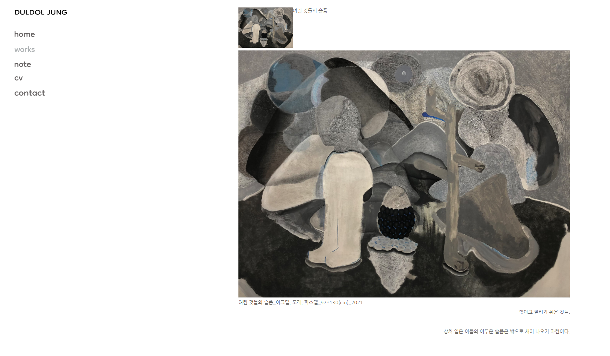
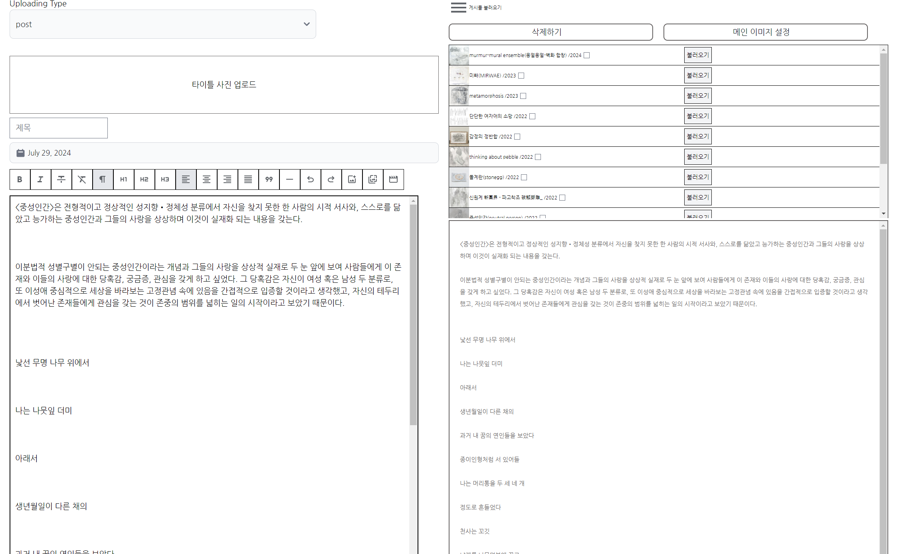

# https://www.duldoljimi.com

## 콘텐츠 저장 구조 전환

프론트는 기존 React/Vite + Vercel을 유지하고, 콘텐츠 API는 Cloudflare Workers,
작품·페이지 데이터는 D1, 이미지는 R2에 저장합니다. 관리자 쓰기는 Cloudflare Access JWT로 검증합니다.

`VITE_CONTENT_API_URL`을 설정하기 전 공개 페이지는 기존 정적 콘텐츠를 읽습니다.
API 연결 후에는 글·이미지 변경에 Git 커밋이나 Vercel 재배포가 필요하지 않습니다.
관리자 비밀번호·GitHub 토큰을 프론트 환경변수로 넣지 않습니다.

**다른 컴퓨터에서 이어서 작업할 때는 [새 PC 인계 매뉴얼](docs/new-computer.md)부터 읽으세요.**
현재 원본과 UUID 매핑은 Git에 포함되므로 `.migration/`을 다시 생성할 수 있습니다.
설정, 로컬 실행, 데이터 이관과 운영 전환 순서는 [Cloudflare 이관 문서](docs/cloudflare-migration.md)를 참고하세요.
아래 설명은 전환 전 구조의 기록입니다.

정들돌 작가 포트폴리오 웹 사이트

## 기술 스택
* React + Vite + Vercel
* Tailwind CSS

* Tiptap Editor

## 설명
예술 작가 포트폴리오 사이트 제작 프로젝트

적은 예산으로 게시물 포스팅이 가능한 것을 목표로 둔 프로젝트입니다.

tiptap editor로 나온 output html 파일을 git 레포지토리에 덮어쓰거나 생성하는 구조로, DB 역할의 파일들은 Json 파일로 저장됩니다.

서버리스보다 더 저수준 단계의 구조를 구현 방향으로 설계하였습니다.
